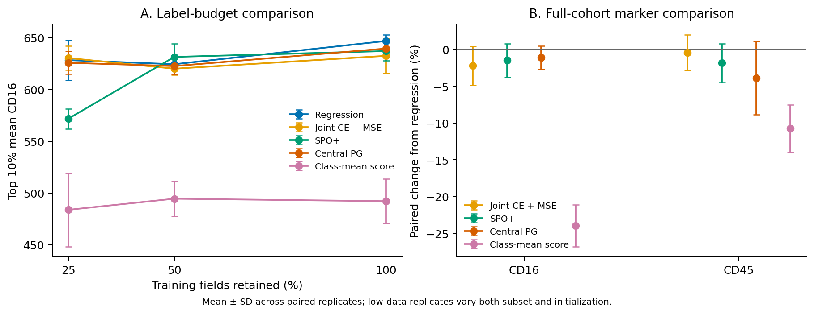

# Predict, then Select

Predictive objectives for label-free cell selection.

**Yuntian Yang and Yiyang Zhang · MIT 9.520, Group 6**

A model that predicts marker levels well may not select the most useful cells. We compare regression, auxiliary cell-type classification, and decision-focused losses using the same CNN–ViT encoder. The downstream task is to select cells with high CD16 or CD45 from four-channel microscopy images.



The figure shows mean selection utility across three paired runs. Error bars are run-to-run standard deviations.

## Findings

- A continuous readout recovers much of the classifier-score deficit. With the CE encoder frozen, replacing its class-mean score with a marker head raises top-10% CD16 utility from **492.1 to 631.4**.
- Decision-focused training is not consistently better than regression. At the smallest training budget, SPO+ loses **56.6** utility units relative to MSE; the conditional 95% field-bootstrap interval is **[−77.2, −26.0]**.
- Auxiliary classification gives modest CD16 gains on both external slides, but the same pattern does not hold for CD45.

The main cohort has 9,437 eligible cells from BSCCMNIST. External evaluation uses all 27,074 eligible cells from a second acquisition batch, with each slide treated as a separate candidate pool. The within-slide follow-up reuses an earlier test set and is exploratory. Field-bootstrap intervals condition on the fitted models and validation choices; they do not establish donor-level generalization.

[Methods](docs/method.md) · [Downloads](docs/downloads.md) · [Reproduction](docs/reproduce.md) · [Result tables](results/README.md) · [References](docs/references.bib)

## Quick start

Open the [pretrained-model notebook in Colab](https://colab.research.google.com/github/yyttim/predict-then-select/blob/main/notebooks/pretrained_models.ipynb) to evaluate the released checkpoints. It downloads the required files, checks their hashes, and compares prediction error with cell-selection utility across all three seeds.

The complete prepared cohorts, selected weights, and per-cell results are on [Google Drive](https://drive.google.com/drive/folders/1E0WlKM2xjE1Sibodr_qwCAW4Hl-ZGwfm). See [Downloads](docs/downloads.md) for contents and checksums. A copy of the notebook is also in that folder.

Use Python 3.11 or later. Install a PyTorch build for your hardware, then install the package and test dependencies:

```bash
python -m venv .venv
# Linux/macOS: source .venv/bin/activate
# Windows: .venv\Scripts\Activate.ps1
python -m pip install -e ".[data,dev]" -c requirements-reproduce.txt
python -m pytest -q
```

For a short training example, open the [demo in Colab](https://colab.research.google.com/github/yyttim/predict-then-select/blob/main/notebooks/cell_selection_extended.ipynb) and upload [colab_extended_demo.zip](results/colab_extended_demo.zip). It trains the full model on 1,201 cells from complete training fields. The five-epoch demonstration is separate from the reported experiments.

The [reproduction guide](docs/reproduce.md) covers data preparation, the full training grid, model selection, and analysis.

## Structure

```text
src/cellselect/   Models, losses, training, and evaluation
scripts/         Data preparation and experiment commands
configs/         Experiment settings
tests/           Numerical and pipeline tests
notebooks/       Pretrained evaluation and training demo
results/         Published tables and figures
vendor/          Reference model and upstream license
```

## Sources

Data come from the [Berkeley Single Cell Computational Microscopy dataset](https://doi.org/10.5061/dryad.sxksn038s), released under CC0. The encoder is adapted from [Nazir and Behera's CNN–ViT](https://doi.org/10.1007/978-3-032-31666-0_41). The original model and its MIT license are retained in [vendor/](vendor/README.md).

Decision losses follow [Elmachtoub and Grigas](https://doi.org/10.1287/mnsc.2020.3922) and [Gupta and Huang](https://proceedings.neurips.cc/paper_files/paper/2024/hash/907a9fb75a408f6c3a2ae1bf84c39e44-Abstract-Conference.html).
