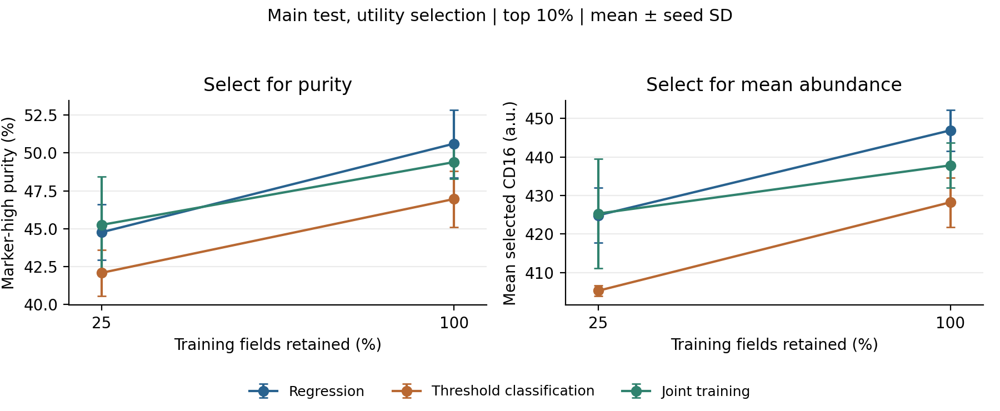

# Predict, then Select

Learning marker levels and selecting marker-high cells from label-free images.

**Yuntian Yang and Yiyang Zhang · MIT 9.520, Group 6**

The cells with the highest expected marker levels need not be the cells most likely to exceed a target threshold. We compare regression, threshold classification, and joint supervision in an offline study using the same CNN–ViT. Every score is evaluated for both mean marker abundance and the fraction of selected cells that meet the threshold.

The study uses all **37,254** eligible single-antibody CD16 cells in BSCCMNIST. Batch 0 contains 9,397 cells for grouped training, validation and test partitions. The 27,857 cells in batch 1 form a separate external pool. The marker-high cutoff is fixed from the smallest training subset; no held-out labels enter its definition.

[Results](docs/results.md) · [Method](docs/method.md) · [Downloads](docs/downloads.md) · [Reproduction](docs/reproduce.md) · [References](docs/references.bib)

## Findings

- Regression is a strong baseline. It selects higher mean-marker cells than threshold classification, which does not establish a purity advantage in the primary comparisons.
- A score can favor one use at the expense of another. With full-data joint weights held fixed, probability scoring instead of mean scoring adds 0.167 percentage points of external purity while lowering mean CD16 by 5.45 units.
- Better probability loss need not improve marker-high purity. In the exploratory stopping-rule check, quarter-data BCE lowers external log loss from 0.437 to 0.166, while purity falls from 6.509% to 6.150%.



Each panel uses models selected for its own validation utility. Bars show sample SD across three training seeds. The [results discussion](docs/results.md) reports paired field intervals and the limits of these comparisons; the external purity ceiling is 8.256% at the 10% selection budget.

Open the [pretrained-model notebook in Colab](https://colab.research.google.com/github/yyttim/predict-then-select/blob/main/notebooks/pretrained_models.ipynb) to evaluate the fixed models. Complete prepared data, selected weights, and reference results are on [Google Drive](https://drive.google.com/drive/folders/1A3sDK0kEPocnoLUpg5mFG3833X6mmXEZ).

## Experiment

| Method | Training target | Selection score |
| --- | --- | --- |
| Regression | Continuous CD16 abundance | Predicted abundance |
| Threshold classification | Whether CD16 reaches the fixed cutoff | Event logit |
| Joint supervision | Both targets | Mean head or event head, according to the intended use |

The grid has 30 runs: five objective settings, two training-field budgets, and three paired seeds. All use the full 1.29-million-parameter model and the same 5,200 optimizer updates. The quarter-data condition uses fewer training fields while retaining the same architecture and update budget.

Model selection uses validation utility at a 10% selection budget. The fixed choices are evaluated at 5%, 10% and 20% on complete held-out pools. Main and external results are reported separately because acquisition and marker-measurement scales can differ.

## Run

Install Python 3.11 or later and PyTorch for your hardware, then install the package in a virtual environment:

```text
python -m pip install -e ".[data,dev]" -c requirements-reproduce.txt
python -m pytest -q
```

After preparing the official data as described in the [reproduction guide](docs/reproduce.md):

```text
python scripts/run_study.py --data data/prepared/cd16_selection
python scripts/evaluate_study.py freeze --data data/prepared/cd16_selection
python scripts/evaluate_study.py test --data data/prepared/cd16_selection
python scripts/evaluate_study.py external --data data/prepared/cd16_selection
python scripts/summarize_study.py
python scripts/summarize_study.py --pool external
```

## Sources

Data are from [BSCCM](https://doi.org/10.5061/dryad.sxksn038s), released under CC0. Marker-high is an operational threshold on the released abundance estimates, not a clinical positivity label.

The encoder follows [Nazir and Behera](https://doi.org/10.1007/978-3-032-31666-0_41); the original model and MIT license are retained in [vendor/](vendor/README.md). The comparison between continuous and binary supervision is also motivated by [Rauschenberger and Glaab](https://doi.org/10.1080/02664763.2023.2233057).

The earlier cell-type study remains available at its [recorded revision](docs/previous-study.md).
